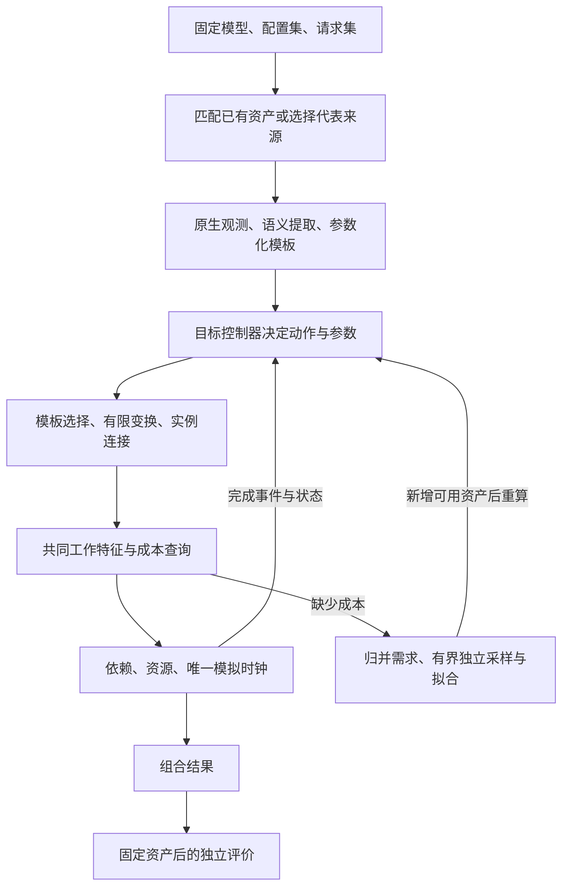

# 项目架构与长期路线

Markov 用真实推理框架取得可复用的子图模板，在目标配置和请求序列下动态组织这些模板，再用独立测得的工作成本预测 serving 性能。目标是用户输入简单、机制可解释、适配容易维护；不重建完整推理框架。

本文定义长期机制和职责，不记录任务进度、实验结果或窗口待办。设计描述约束实现；具体组合是否具备运行、结构和精度资格，必须分别取得证据。

## 输入、输出与机制

输入是**一个固定模型 × 多个配置 × 多个 request workload**。模型和请求描述执行什么；配置描述框架、并行策略、后端、资源与部署。用户不指定 base，由系统选择代表性结构来源并复用已有资产。

输出按配置与请求集合逐组合报告 modeled 范围内的指标、缺口、假设及来源。目标是预测统一流程，默认不包含模型加载、首次编译、预热、HTTP、分词及流程外后台服务。

目标 DAG 是控制与执行循环逐步产生的结果。控制器依据目标到达、完成和资源状态重新组批，不能复制 base 的批次次序或等待时长。

结构开发先使用显式给定节点耗时，验证“统一流程 + 真实模板 + 目标配置 + 轻量控制器”能够展开正确结构。真实成本随后接入同一执行核；给定耗时不构成性能样本或精度证明。

## 三种粒度

| 对象 | 作用 | 边界 |
| --- | --- | --- |
| 流程 block | 控制器调用的稳定动作，带参数、端口和状态效果 | 不等于原生函数 |
| 内部语义区域 | 可独立复用、变换或组合的子图 | 可以跨线程、stream 和 rank |
| 性能单元 | 有明确特征和测量边界的可计费工作 | 可以是节点或局部子图，不要求与语义区域一一对应 |

语义树表示归属与组合，DAG 表示真实依赖与并发，性能单元表示计费边界。父区域不能再叠加已经由子工作承担的费用；跨区域融合工作也只能计费一次。

源 DAG 是一次原生执行的事实，不是所有目标结构的全集。模板需要额外声明参数关系、有限实现分支、资源与端口约束，才能生成来源中没有逐项出现的合法实例。

## 统一 serving 流程

顶层保留 Schedule、Prepare、Prefill、Decode、Publish 五类动作。到达、等待和终止属于控制交互，不伪造为收费模板。

| 动作 | 职责 | 主要完成端口 |
| --- | --- | --- |
| Schedule | 根据可见请求、已发布进度及容量形成选择，保留过滤、合并和空决定的工作 | Selected |
| Prepare | 准备输入规格、请求槽位和 KV 元数据 | Prepared |
| Prefill | 执行本批 prompt 对应的模型工作 | Submitted、DeviceDone |
| Decode | 根据已有上下文执行下一 token 的模型工作 | Submitted、DeviceDone |
| Publish | 结果物化、必要搬运与处理，发布 token 并提交完成效果 | Published |

Prepared 不表示全部设备输入已经到位；Submitted 不表示设备完成。设备节点从各自的提交依赖启动，DeviceDone 也不强制晚于 Submitted。Publish 的入口可以依赖 Submitted，结果出口仍等待必要设备及传输工作，不能因阶段划分增加全局屏障。

Prefill/Decode 内部依模型结构分层，例如 embedding、重复 decoder layer、attention、MLP、归一化/残差和输出 head。模型结构提供语义骨架，原生实现决定融合、通信、KV 和同步如何映射。层号、具体调用及重复次数属于绑定与实例，不自动成为新的结构种类。

## 控制、状态与时间

共同控制接口接受到达和工作端口完成事件，返回统一动作及参数，不暴露框架私有对象或可任意修改的内部图。

| 状态或行为 | 唯一负责方 |
| --- | --- |
| 请求进度、等待队列、批次成员、准入、逻辑 KV/槽位 | 轻量控制器 |
| 模板定义、参数求值、合法变换 | 模板资产与实例化对象 |
| 目标图、资源前沿、workspace 状态、完成事件和模拟时钟 | 执行与图装配对象，按各自职责持有 |
| 工作耗时与适用性 | 成本提供者 |
| 原生采样时的请求、KV、worker 及清理 | 推理框架 |
| 资产、进程、预算、发布和恢复 | 外围 workflow |

控制器在调度入口取得快照并预约工作，在对应端口完成后提交效果。目标实际页身份、请求槽位和释放关系须一致，不能只维护总 token 数。模板声明工作及状态依赖，不另存一套可变请求状态。

轻量控制基线为 FCFS、Prefill/Decode 分开、每副本一个在途模型批次；模板内部仍允许 CPU、设备、通信和传输按依赖重叠。接纳、过滤、合并及发布按声明规则推进。Prefill 已生成第一个输出 token；输出 N 个 token 对应一次 Prefill 和 N−1 次 Decode。最后 Published 后终止，不附加无限 idle polling。

准入比例、预算、页与池容量由公共控制参数和目标状态解释。内存压力下的回退、抢占或其他未表达行为需要真正的控制能力，不能以多采一个模板代替。

时间统一为相对窗口起点的整数 ns。运行时取最早时刻的整组事件，先更新完成端口和指标，再将整组交给控制器；同刻保留登记顺序。不能声称已经强制“完成优先于到达”。同刻产生的新事件继续在该时刻处理，时间不倒退。模拟器自身运行耗时不计为目标 CPU 成本。

## 四个必须分别解决的问题

| 问题 | 统一处理原则 |
| --- | --- |
| CPU 如何计时 | 分开自身服务、依赖等待和实际搬运；取得相同切口与特征的独立样本 |
| CPU 路径如何变化 | 循环量参数化，稳定组合按规则重组；真正影响接口或实现的分支才形成变体 |
| 子图如何分层 | 按复用、变换、状态或外部事件需要切分；父子自身工作与组合分开 |
| 模板如何归一化 | 稳定定义与调用身份、动态参数、资源绑定和目标实例分开 |

CPU 计时切口在结构设计时就必须明确，真实标签在结构成立后取得。成本命中、模板数量下降或总耗时接近都不能替代上述逻辑。

## 适配与代码边界

跨框架的主要扩展入口是**子图获取、模板生产和性能观测适配**。不同框架产出的图可以不同，但必须满足同一公共合同，供共同控制器、模板消费者、成本接口和执行核使用。

| 层次 | 应承担 | 不应承担 |
| --- | --- | --- |
| 框架适配 | 原生 hook、步骤/端口绑定、请求配方、框架状态读取 | 第二套仿真时钟或私有调度器 |
| 框架内模型适配 | 模块层次、模型维度、原生布局及参数关系 | 将某个模型的函数名扩散到核心 |
| Runtime 适配 | profiler/SDK、线程/任务/通信关联、时钟、环境补丁 | 反向解释请求策略和模型语义 |
| 公共生产层 | 类型化事实、共同归属、子图切口和生产流程 | 识别具体框架名称 |
| 模板、控制、成本、执行核心 | 参数化、状态、资源、查询和事件反馈 | 读取原生 trace 或调用框架私有函数补语义 |
| Workflow / CLI | 具体实现装配、输入、资产与进程交接 | 再写一份规则或支持黑名单 |

C++ 拥有流程合同、提取、模板化、目标控制和仿真；Python 消费公共绑定，负责原生观察、采样及进程交接。两种语言不各自维护一套 block 定义。共同机制按真实职责复用，差异留在相应适配器，不能机械要求每个 block 一个派生类。

构建依赖向内：`workflow → adapters → core`。框架适配可组合 runtime，runtime 不反向依赖框架；公共 Python instrumentation/artifacts 不导入具体适配器。头文件传递依赖也受同一约束。

## 泛化空间与长期路线

| 变化 | 必要能力 |
| --- | --- |
| 请求长度、成员、到达、合法 KV/字节量 | 已有模板参数关系、控制规则与对应成本覆盖 |
| 已知实现分支或融合变化 | 有依据的有限变体、选择条件和接口 |
| 模型、TP、backend、dtype 或环境变化 | 重新判断来源与成本适用性，必要时重新取结构；不能按比例缩时延 |
| overlap、缓存命中、chunk/mixed、抢占等 | 相应控制、状态、事件和模板能力 |

长期顺序是：输入与共同合同 → 有界结构获取 → 固定模板的动态展开 → 独立成本与自动需求交接 → 独立精度和使用体验 → 按收益扩展框架与机制。这是能力依赖，不是实时任务清单。

开发路径以 SGLang + Qwen3-32B / Ascend 为起点，KTransformers 后续按同一合同适配。KT 的 CPU 专家计算属于实际计算工作，不能作为可忽略的 host 控制开销。

原生控制器是另一个可选扩展：只有确需其调度行为且维护收益明确时，才通过共同动作/事件接口替换轻量控制器。它需要隔离真实设备执行、原生 timer/线程和状态回传；常规框架接入不以实现它为前提，也不预建占位后端。

流程外耗时默认排除，必要因果仍要以输入、初态或端口表达。若无法确定影响范围内工作的行为，保留缺口或不支持结论，不能因忽略耗时而删除依赖。
