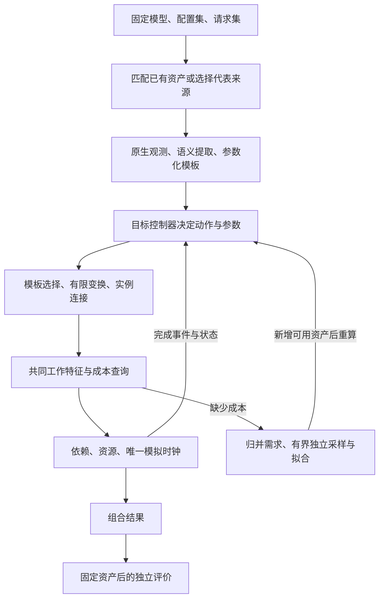

# 项目架构与长期路线

Markov 用真实推理框架取得可复用的子图模板，在目标配置和请求序列下动态组织这些模板，再用独立测得的工作成本预测 serving 性能。目标是用户输入简单、机制可解释、适配容易维护；不重建完整推理框架。

本文定义长期机制和职责，不记录任务进度、实验结果或窗口待办。设计描述约束实现；具体组合是否具备运行、结构和精度资格，必须分别取得证据。

## 输入、输出与机制

输入是**一个固定模型 × 多个配置 × 多个 request workload**。模型和请求描述执行什么；配置描述框架、并行策略、后端、资源与部署。用户不指定 base，由系统选择代表性结构来源并复用已有资产。

输出按配置与请求集合逐组合报告 modeled 范围内的指标、缺口、假设及来源。目标是预测统一流程，默认不包含模型加载、首次编译、预热、HTTP、分词及流程外后台服务。

目标 DAG 是控制与执行循环逐步产生的结果。控制器依据目标到达、完成和资源状态重新组批，不能复制 base 的批次次序或等待时长。

项目按两个阶段交付：先使用显式给定节点耗时，收口“统一流程 + 真实模板 + 目标配置 + 轻量控制器”的动态结构，再固定规则和资产进行独立结构验证；通过后接入性能需求、独立采样和成本模型。上图描述长期闭环，给定耗时不构成性能样本或精度证明。

## 三种粒度

| 对象 | 作用 | 边界 |
| --- | --- | --- |
| 流程 block | 控制器调用的稳定动作，带参数、端口和状态效果 | 不等于原生函数 |
| 内部语义区域 | 可独立复用、变换或组合的子图 | 可以跨线程、stream 和 rank |
| 性能单元 | 有明确特征和测量边界的可计费工作 | 可以是节点或局部子图，不要求与语义区域一一对应 |

语义树表示归属与组合，DAG 表示真实依赖与并发，性能单元表示计费边界。父区域不能再叠加已经由子工作承担的费用；跨区域融合工作也只能计费一次。

源 DAG 是一次原生执行的事实，不是所有目标结构的全集。模板需要额外声明参数关系、有限实现分支、资源与端口约束，才能生成来源中没有逐项出现的合法实例。

## 目标并行与采集执行

目标配置声明逻辑 TP、模型实现与硬件条件；采集部署声明运行观察器的实际设备。两者不能以“设备列表长度必须等于目标 TP”合为一个概念。单卡采集在一张兼容设备上执行目标 rank 的分片工作，之后由模板和并行规则装配目标各 rank；不同角色可顺序观察，不要求现场拥有目标数量的卡。

本地执行保留原生模型算子、backend、布局与请求/KV 生命周期。分片不等于把请求长度、hidden width 和全部模型维度除以 TP；模型/并行适配解释头分片与复制、线性层轴、词表、层角色和必要通信。语义与性能插桩共用同一分片执行描述及底层，分别取得结构事实和独立时延。

单卡分片的具体执行策略由框架 adapter 拥有，可随模型、原生版本和 backend 变化。配置缩维、原生分片模块接入、加载及通信替代均留在适配端；公共合同只表达工作、布局、角色与接口，不强制所有框架采用 TP1 引擎或相同启动方法。Python 原生适配与 C++ 模板生产适配交接事实，共同核心不解释框架私有参数，同一分片规则不跨语言重复实现。

本地实测、并行规则生成的连接以及为继续执行而提供的辅助张量须区分来源。collective 的参与者、数据量和输入/输出端口保留，单卡替代不产生通信成本。主 rank 的控制/发布工作与普通 rank 不默认相同；只能按已证明的角色等价复用。真实跨卡通信、争用及分布式性能仍需相应数据，缺失不填零。

模型/实现身份、硬件条件与采集位置分别保存。复用由结构或成本所需的模型来源、外部实现修订、实际镜像/runtime 及工作条件判断；路径、service 名和卡号仅是定位事实。纯预测消费已声明身份和资产，不为了检查现场卡数而启动原生环境。不会另建内部版本兼容或自造指纹体系。

## 统一 serving 流程

顶层保留 Schedule、Prepare、Prefill、Decode、Publish 五类动作。到达、等待和终止属于控制交互，不伪造为收费模板。

| 动作 | 职责 | 主要完成端口 |
| --- | --- | --- |
| Schedule | 根据可见请求、已生成进度及容量形成选择，保留过滤、合并和空决定的工作 | Selected |
| Prepare | 准备输入规格、请求槽位和 KV 元数据 | Prepared |
| Prefill | 执行本批 prompt 对应的模型工作 | Submitted、DeviceDone |
| Decode | 根据已有上下文执行下一 token 的模型工作 | Submitted、DeviceDone |
| Publish | 结果物化、必要搬运与条件输出，提交生成进度、结束和 KV 效果 | ResultProcessed |

Prepared 不表示全部设备输入已经到位；Submitted 不表示设备完成。设备节点从各自的提交依赖启动，DeviceDone 也不强制晚于 Submitted。Publish 的入口可以依赖 Submitted，内部结果处理和实际输出各自等待必要设备及传输工作，不能因阶段划分增加全局屏障。

ResultProcessed 是每轮内部控制端口，不表示该请求已经输出。只有实际发送角色在输出服务出口交出新增 token，才产生逐请求 RequestOutput 事件；同一批可以只输出部分成员，也可以只有空消息。请求指标从这些实际输出事件取得，输出事件不维护另一份请求/KV 状态。当前 modeled 输出边界为 scheduler 向下游 detokenizer 交出 token 的服务返回，不包含 detokenizer、HTTP 或客户端接收。

rank 的本地端口、控制参与、输入接收与输出发布角色分别绑定。控制就绪由声明参与者的端口决定，请求指标按输出角色的实际可见时刻计算；两者可以不同。原生下一轮入口存在接收或广播协调时，保留其因果依赖，不能由当前输出已可见推断下一轮已可执行。

Prefill/Decode 内部依模型结构分层，例如 embedding、重复 decoder layer、attention、MLP、归一化/残差和输出 head。模型结构提供语义骨架，原生实现决定融合、通信、KV 和同步如何映射。层号、具体调用及重复次数属于绑定与实例，不自动成为新的结构种类。

## 控制、状态与时间

共同控制接口接受到达和工作端口完成事件，返回统一动作及参数，不暴露框架私有对象或可任意修改的内部图。

| 状态或行为 | 唯一负责方 |
| --- | --- |
| 请求进度、等待队列、批次成员、准入、逻辑 KV/槽位 | 轻量控制器 |
| 模板定义、参数求值、合法变换 | 模板资产与实例化对象 |
| 目标图、资源前沿、动态运行时资源、完成事件和模拟时钟 | 执行与图装配对象；初始化保证的不变量由资产声明 |
| 工作耗时与适用性 | 成本提供者 |
| 原生采样时的请求、KV、worker 及清理 | 推理框架 |
| 资产、进程、预算、发布和恢复 | 外围 workflow |

控制器在调度入口取得快照并预约工作，在对应端口完成后提交效果；ResultProcessed 推进生成进度与结束效果，RequestOutput 只更新结果计时。目标实际页身份、请求槽位和释放关系须一致，不能只维护总 token 数。模板声明工作及状态依赖，不另存一套可变请求状态。

轻量控制基线为 FCFS、Prefill/Decode 分开、每副本一个在途模型批次；模板内部仍允许 CPU、设备、通信和传输按依赖重叠。控制器在当前模拟时刻查看已到达请求，产生不可变批次快照；本批完成后再作下一次决定。在空闲控制工作期间到达的请求参与其后的组批，不复制原生输入 handler 或接收循环。该策略需独立验证适用性，不保证复现原生 scheduler 的全部启发式。Prefill 已生成第一个输出 token；输出 N 个 token 对应一次 Prefill 和 N−1 次 Decode。请求结果按最后可见 Published 计时，不附加无限 idle polling。

准入按 FCFS 为每个请求预留完成前需要的峰值页数，即 `ceil((prompt_tokens + output_tokens − 1) / page_size)`；实际页所有权随 KV 驻留量增长，不一次分配全部预留页。已有请求保留该预算，新请求在槽位、框架可见占用、页预算和 Prefill 预算允许时进入；可准入的新 Prefill 优先，其余轮次 Decode 全部活动成员。框架可见占用来自用于连接子图的同一批次视图，可以包含已结束但尚未过滤的成员，不等于逻辑活动请求数。非 chunked Prefill 在预算尚为正时接纳完整请求，再按适配器提供的粒度扣除预算；最后一个请求可以使预算耗尽或超出。当前 SGLang 固定输出、cold-cache 路径按页计量，批次的 M 仍是实际新增 token 数。

计划生成不修改页或请求进度，输入准备提交时分配槽位与新页，结果处理完成时推进生成并释放结束成员的资源。批次只携带新分配页和必要成员快照，不逐轮复制全部 KV 页表。控制器使用外部完成事件，不产生另一套执行时钟；该轻量策略不保证复现原生调度器的全部启发式。回退、抢占或其他未表达行为需要对应控制能力。

逻辑槽位按 FIFO 分配与归还，逻辑页从空闲队首取用。适配器按原生规则提供归还次序，控制器提交同一有序结果：SGLang Prefill 按请求归还，Decode 合并完成成员后归还，不能统一假定整个完成组全局排序。批次只补充上一驻留页，供适配器处理页尾复用；完整页表仍由控制器唯一持有。原生保留槽位、保留页和索引 dtype 的编码约束由框架适配器处理，不改变逻辑身份的含义。

工作流从共同批次接口读取逐组的 `AdmissionConstraints`，包含框架可见占用和 Prefill token 预算粒度，再由控制器交出带任务身份的只读批次和完成快照；框架适配器将它们绑定到具体模板入口、端口及原生操作数编码。逻辑 rank、源通信角色、目标参与组与设备位置分别绑定，共同连接算法按目标组匹配参与者。占用量按原生调度顺序从既有视图推导，不另存一套请求状态或决定哪些请求准入。适配器保留目标图和当前值端口，不维护第二份页所有权；公共图对象负责类型、几何、别名与身份连接。对应图装配成功后，控制器才提交分配或完成效果。

任务身份由目标组和组内序号组成，随动作、执行程序和完成事件交接。工作流按任务保留不可变动作及待提交的页归还结果，执行器持有端口通知；反馈先按模拟时间、再按同刻提交顺序处理，同任务先发布再完成。请求状态提交与用户输出分别声明。没有输出的工作仍需完成端口，已声明输出的动作不能缺少发布端口；历史回收须保留所有在途动作和状态前沿。

时间统一为相对窗口起点的整数 ns。执行器按事件时刻推进，输出可见事件更新请求计时，结果处理完成事件提交控制状态；逻辑到达由下一次控制决定读取。无事件时，先完成必要空闲控制，再推进到控制就绪与下个到达的较晚者。模拟时钟不回退，模拟器自身运行耗时不计为目标 CPU 成本。

执行核增量接收新工作及仍存活的依赖，前驱完成后才进入资源就绪队列。同一资源按就绪时刻和节点身份稳定串行服务，不因构图或提交顺序提前预占未来资源；原生线程和 stream 的程序次序仍由图依赖维护。模拟推进遇到请求到达即交回控制，不能越过它预先确定后续批次的时刻。

执行器保留未完成节点、服务时间、后继和端口通知，图装配侧保留活跃值及状态绑定；两者使用稳定节点身份交接前沿。已完成且不再引用的历史可释放，不能每批重算全部历史；任务完成不要求耗尽所有异步尾部。完整图及节点实际执行时刻按诊断需要从同一执行流输出。外围新增资产后从初态重算，和单次仿真的增量计算是不同职责。

## 调度与多级前缀缓存的扩展原则

分块、混合组批和 Decode 优先通过共同控制接口表达，不复制 serving 生命周期。成员快照分别记录本轮 token 范围、已有 context 和阶段，模板按实际成员组合；中间进度、用户输出和资源释放有各自端口。组批策略改变不等于在模板中固定另一条完整控制轨迹。

引入 prefix caching 时，控制侧将实际 KV 分配与引用集中到一个资源组件，请求、缓存索引与存储层共用这份事实。缓存逻辑分为：按完整内容前缀及复用域匹配的索引、具体层的容量/驻留与就绪、决定保留/淘汰/迁移的策略。它们以组合和明确接口协作，不能在每一层复制请求状态或另存一份总页账。

前缀身份与存储位置分开；多个层可以持有同一内容的不同副本，每个副本的实际空间分别计量。逻辑命中不意味着设备可立即消费：非执行层的副本需要搬运和完成依赖，迁移期间保护源数据与目的空间。模型、KV 布局和分片兼容性决定能否复用，物理地址不构成内容身份。

首期实现设备端一层，直接使用设备 KV 池，逻辑匹配和就绪合同仍遵循上述分层。CPU/磁盘存储及跨层预取、回写只在实际接入时实现，不预建空后端或通用存储平台；PD 服务间交接可使用共同传输表达，但与前缀缓存具有不同生命周期。

缓存项在对应写入完成后才可共享。活跃请求持有引用，结束时解除引用而非直接释放缓存页；替换只能处理可淘汰项。未对齐尾部、完整 prompt 命中后的必要计算以及缓存相关 CPU/搬运工作，由原生接口和模板规则表达，不能只减掉若干 token 后忽略其他影响。

## 四个必须分别解决的问题

| 问题 | 统一处理原则 |
| --- | --- |
| CPU 如何计时 | 分开自身服务、依赖等待和实际搬运；取得相同切口与特征的独立样本 |
| CPU 路径如何变化 | 循环量参数化，稳定组合按规则重组；真正影响接口或实现的分支才形成变体 |
| 子图如何分层 | 按复用、变换、状态或外部事件需要切分；父子自身工作与组合分开 |
| 模板如何归一化 | 稳定定义与调用身份、动态参数、资源绑定和目标实例分开 |

CPU 计时切口在结构设计时就必须明确，真实标签在结构成立后取得。成本命中、模板数量下降或总耗时接近都不能替代上述逻辑。

## 适配与代码边界

跨框架的主要扩展入口是**子图获取、模板生产和性能观测适配**。不同框架产出的图可以不同，但必须满足同一公共合同，供共同控制器、模板消费者、成本接口和执行核使用。

| 层次 | 应承担 | 不应承担 |
| --- | --- | --- |
| 框架适配 | 原生 hook、步骤/端口绑定、请求配方、框架状态读取 | 第二套仿真时钟或私有调度器 |
| 框架内模型/并行适配 | 模块层次、分片与 rank 角色、原生布局、参数关系及通信接口 | 将某个模型的函数名或采集辅助执行扩散到核心 |
| Runtime 适配 | profiler/SDK、线程/任务/通信关联、物理实现分支与布局、时钟、环境补丁 | 反向解释请求策略和模型语义 |
| 公共生产层 | 类型化事实、共同归属、子图切口和生产流程 | 识别具体框架名称 |
| 模板、控制、成本、执行核心 | 参数化、状态、资源、查询和事件反馈 | 读取原生 trace 或调用框架私有函数补语义 |
| Workflow / CLI | 具体实现装配、输入、资产与进程交接 | 再写一份规则或支持黑名单 |
| Validation | 消费固定预测和独立观察，比较工作、接口、依赖及状态 | 回流修改模板、被验预测或控制器状态 |
| Example | 具体实验输入、验证矩阵、批量调用及结果汇总，消费公开入口 | 被业务代码依赖，或复制调度、模板规则及采集生命周期 |

C++ 拥有流程合同、提取、模板化、目标控制和仿真；Python 消费公共绑定，负责原生观察、采样及进程交接。两种语言不各自维护一套 block 定义。共同机制按真实职责复用，差异留在相应适配器，不能机械要求每个 block 一个派生类。

构建依赖向内：`workflow → adapters → core`。框架适配可组合 runtime，runtime 不反向依赖框架；公共 Python instrumentation/artifacts 不导入具体适配器。头文件传递依赖也受同一约束。

模板适配遵循取得事实、绑定语义、共同提取、编译有限规则、共同归一化与发布的顺序。适配器提供原生差异和规则依据，共同代码执行切图和改写；预测只消费已发布规则及配置解释，不重新调用原生代码推演目标。

## 泛化空间与长期路线

| 变化 | 必要能力 |
| --- | --- |
| 请求长度、成员、到达、请求池与 KV 总容量 | 模板参数/容量变换、目标初态与控制规则；性能另需对应成本覆盖 |
| 已知实现分支或融合变化 | 有依据的有限变体、选择条件和接口 |
| 页大小、同架构模型尺寸与 TP | 页布局、模型参数、分片、角色和通信的明确关系；已有模板与规则能表达时复用，否则取得缺失来源 |
| dtype、量化、attention backend、运行库或硬件实现变化 | 取得对应操作、布局和物理实现依据；已证明不变的部分可以共享，物理资格和成本适用性分别判断 |
| overlap、缓存命中、chunk/mixed、抢占等 | 相应控制、状态、事件和模板能力 |

配置名称改变不等于结构必然不能变换。复用边界由已知语义、可求值参数、有限变体及状态/资源合同共同决定；重新采集是补足事实的工程选择，不是所有跨域变化在原理上均不可表达。镜像重新命名、路径或卡号改变也不产生新的物理实现。

单条来源轨迹不能自行确定未观察且未声明的分支；仅有长度输入也不能唯一决定缓存命中、EOS 或内容路由。这类目标需要额外状态、规则或观察。目标本身不符合原生后端约束时，没有对应的合法执行；不能用模板变换制造支持。规则允许展开、独立结构对照相符和性能精度通过是三个不同结论。

长期顺序是：输入与共同合同 → 有界结构获取 → 模板动态展开 → 固定规则后的独立结构验证 → 独立成本与自动需求交接 → 独立精度和使用体验 → 按收益扩展框架与机制。这是能力依赖，不是实时任务清单。

开发路径以 SGLang + Qwen3-32B / Ascend 为起点，KTransformers 后续按同一合同适配。KT 的 CPU 专家计算属于实际计算工作，不能作为可忽略的 host 控制开销。

原生控制器是另一个可选扩展：只有确需其调度行为且维护收益明确时，才通过共同动作/事件接口替换轻量控制器。它需要隔离真实设备执行、原生 timer/线程和状态回传；常规框架接入不以实现它为前提，也不预建占位后端。

流程外耗时默认排除，必要因果仍要以输入、初态或端口表达。若无法确定影响范围内工作的行为，保留缺口或不支持结论，不能因忽略耗时而删除依赖。
