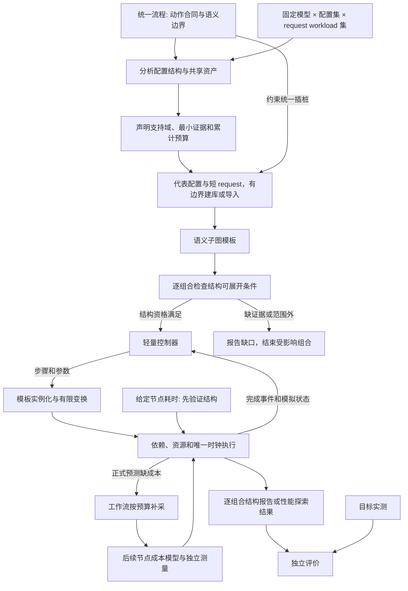

# 阶段一 整体流程与范围

状态：S1 的范围与 S2 类型已有历史收口，当前按 2026-10-09 讨论复核统一流程与真实语义边界。先完成给定节点耗时下的目标结构，再实现成本模型；新增动作合同和插桩原则属于待落实设计，不代表当前代码已验收。真实来源与首轮参数见[框架路径](framework_paths.md)，输入约束见[用户合同](02_user_contract.md)。

2026-10-10 术语更新：model、configuration、request workload 分开。模型在任务内固定；request workload 只描述请求序列。文中仍出现的 base 指某次结构采集来源或现有实现字段，不再是用户必须指定的特殊配置。

实现目录、跨语言交接和修改归属见[代码分层](development.md#c-目录与职责)。适配边界同时区分框架、框架内模型与运行环境；目录和 CMake 依赖共同落实，不能只在概念图上分层。

工作负载（模型与请求）和实现配置（框架、并行、后端与环境）是用户探索的维度；adapter 则是代码职责。适配器为实际支持的组合取得原生事实并生成统一模板，核心消费该合同。框架/模型/runtime 目录表示主要职责，不表示三者能够任意组合；详细输入语义见[用户合同](02_user_contract.md#工作负载配置与适配器)。

## 1. 核心概念

| 概念 | 含义 |
| --- | --- |
| 标准 serving 流程 | 为请求、调度、执行、完成处理等步骤定义共同语义、输入与完成边界；不要求框架内部组织一致 |
| 控制器 | 消费事件和状态，决定下一步工作；首轮为自有轻量实现，后续可通过适配器使用原生控制代码 |
| 源 DAG | 某次代表配置和代表 request 原生执行中的 CPU、设备、传输、通信与依赖；可有多个显式来源，事实保持不变 |
| 语义子图 | 源 DAG 中归属于某个 serving 步骤的一段工作，可能跨线程、stream 和 rank，不一定是连续时间区间 |
| 子图模板 | 语义子图加参数来源、边界端口、效果及允许变换；可以实例化多次 |
| 性能单元 | 估计成本的节点或局部子图，粒度可调整，与语义子图不要求一一对应 |
| 目标执行结构 | 控制器调用模板并经事件反馈逐步展开的实例图，结束后可作为 DAG 分析 |
| 流程定义 | 步骤、可触发分支、控制规则范围、模板类别和排除项的共同描述 |
| 给定节点耗时 | 显式条件输入，用于推进时间、完成事件和控制反馈；不负责预测耗时 |

模板定义说明需要采什么、怎样实例化；模板实例的内部工作来自真实 base 采集。有限变换可以插入有明确语义的节点，例如特定 TP 规则中的通信。任意缺失子图不能靠通用生成器自动补齐。

实现先完成：**定义统一流程 + 按流程采集 base 子图模板 + 目标配置 + 轻量控制器 + 给定的节点耗时 → 动态展开目标执行结构。** 结构正确后再建立 cost model。给定耗时与模型耗时驱动同一执行核；结构验证仍模拟 CPU/NPU 完成和发布时间，不把控制路径假定为与时延无关。

## 2. 原生框架的角色

当前开发与验收对象为 SGLang + Qwen3-32B，KTransformers 是后续扩展对象。SGLang 提供真实运行、观测来源和行为规则依据；预测期间由轻量控制器执行已支持的抽象流程。KT 已有原生采集保留，主线稳定后再补齐其预测适配。

SGLang 的 HiCache 与 KTransformers 的 CPU/设备协同分别作为框架能力扩展。共同部分是请求、工作、事件、模板和性能接口，不把 HiCache 当作通用框架前提。首轮环境从现有 Ascend Docker 起步，其他硬件没有被默认宣称支持。

原生框架“能运行”只说明真实部署可用，不代表其所有参数变化都能被模拟。模型的内容相关路由、输出 token 依赖和未观测分支需要单独的输入或规则依据。

### 框架差异收敛在模板生产端

2026-10-10 明确的架构目标：用户切换推理框架时，只需调整子图如何获取和模板化；不同框架产出的模板遵循同一合同，由同一核心消费。这里的中间层是模板生产端，不是同时承接各框架调度器、KV 管理器和成本实现的万能适配层。

```text
原生框架
  → 框架绑定与差异提取
  → 公共观测、子图提取及模板化流程
  → 统一子图模板合同
  → 共同轻量控制器、模板展开、成本调用与事件执行核
```

统一的是语义与交互合同，不要求不同框架生成相同节点或拓扑。模板表达所属 block/区域、输入参数及单位、适用条件、节点与依赖、资源与完成端口、状态读写、参数关系、有限变换及性能单元描述。框架名、原生函数和来源 span 可以保留为证据，不能成为核心调度、图变换或成本选择中的业务分支条件。算子、融合与硬件差异通过模板的工作描述及公共能力表达。

框架接入端负责原生入口绑定、参数读取、事件关联、特殊结构解释，以及把有依据的分支和参数关系归入统一模板。核心负责通用实例化、有限图操作、状态与资源机制、成本接口和唯一模拟时钟；预测运行不回调框架专属函数来补全语义，也不在核心按 kernel 名补框架特例。新的通用机制确有必要时，统一扩展合同和公共实现，不预建规则语言或插件平台。

共同控制器执行所声明的控制策略。框架特有行为如果超出共同流程或资源语义，应明确不支持或作为公共能力扩展，不能把一套私有调度器藏进模板生产端。KV 的申请/释放需求及生效端口通过合同表达，目标状态只有一个维护者；不同原生 allocator 的实现不应迫使核心加入框架名称判断。使用共同策略的结果不自动等于完整复现各框架原生调度。

当前代码尚未达到这一边界：控制器直接依赖 SGLang 配置，部分 KV 顺序和布局规则含当前框架/后端知识。后续需区分通用资源机制与来源解释，将来源识别和专属参数绑定收敛到模板生产端。此项是整改目标，不把当前类型统一、已有采集或同输入回放当作跨框架能力已经完成。

## 3. 端到端流程



1. 定义统一流程和动作合同，框架适配明确原生位置、上下文及节点关联。
2. 用户给一个固定模型、配置集和 request workload 集；系统分析笛卡尔积并选择代表性结构采集，不要求用户指定 base。
3. 参考 Dooly 的轻量发现和共享复用思路，先按原生机制声明支持域、最小证据及累计开销，再用统一插桩采集短代表 request，提取内部节点/依赖、跨模板端口和参数映射。仅有阶段名称或起止时间不足以形成模板；短请求也不自动证明结构可泛化。建库按覆盖条件收口，不以跑通所有目标请求为终点。
4. 检查目标所需控制规则、模板变体、有限变换和资源机制，成本资格另行判断。
5. 控制器消费当前到达/完成事件，选择动作和参数；模板实例化产生工作与依赖，执行核推进唯一时间并反馈状态。
6. 先用显式给定的节点耗时验证同配置与允许变化的动态结构。该结果是条件化结构/时序报告，不提供模型预测精度或收益承诺。
7. 结构资格满足后，将节点/局部子图绑定成本模型；模型缺数据时才进入独立性能补采，完成后从初始状态重算。
8. 正式预测输出 scope 内时间和指标；独立结构核对与性能评价读取原生验证观测，均不能回写生成规则或成本。早期结构核对不等待最终性能模型。

## 4. 动作合同与流程边界

流程 block 定义、原生 block wrapper 和对应子图获取共同遵循[统一 block 抽象](04_collection_templates.md#23-block-定义wrapper-与子图获取的统一抽象)。C++ 核心维护语义合同，Python 采集消费同一合同；框架适配通过绑定和浅层继承提供差异。定义、源观测、子图模板与目标实例分别管理生命周期，使用明确身份关联，不能靠各层独立判断名称维持对应。

统一流程由可组合动作与合法触发关系组成，定义每个动作的输入、工作职责、完成端口、状态效果、可变参数和适用条件。原生位置说明如何观测合同，不能以一个函数名代替合同。框架可以有不同内部调用、线程组织和模板变体，核心使用共同动作语义。

阶段入口是前置数据、状态和资源条件；出口可以有多个端口，分别说明哪些结果可用、哪些外部工作可启动、哪些状态可以提交。输入选择或资源预约若在入口发生，也要在合同中声明，由唯一状态维护者处理。CPU 范围结束、设备完成和 token 发布分别观测。

边界按以下原则核对：

- 同一阶段承担稳定职责，输入/输出明确，能由控制器作为一次动作调用。
- 内部事件若启动模板外工作或改变后续控制决策，就暴露端口；不必把全部内部算子提升为流程阶段。
- 工作归属通过阶段实例和因果关联确定，允许跨线程、stream、rank 和重叠时间；父子函数包络不代表可叠加工作。
- 不为阶段切分增加同步，不把必要状态变化或跨模板依赖归为模板外忽略。

首个主线候选如下。现有代码使用 Schedule/Prepare/Prefill/Decode/Publish；以下合同仍须结合完整原生迭代复核，不能凭枚举已经存在认定划分最终成立。

| 步骤 | 决策或工作 | 主要输入 | 完成后的信息 |
| --- | --- | --- | --- |
| 请求到达 | 请求进入可调度集合 | 到达计划、token 和长度条件 | 新请求可见 |
| 调度与准入 | 选择请求、分配批次预算 | 待处理请求、容量、已完成工作 | 批次计划或继续等待 |
| 准备与提交 | KV/输入准备，提交 prefill 或 decode | 批次、上下文、目标配置 | CPU 提交完成，设备工作就绪 |
| 执行 | 计算、通信、传输 | 模板及变换参数 | 指定输出端口完成 |
| 完成处理 | 更新进度、发布可见状态、释放占用 | 工作完成事件 | 可生成下一轮工作或响应 |

这些动作不是强制的全局串行屏障。例如 CPU 提交完成和设备结果就绪是不同端口，设备工作按对应 launch 依赖启动，结果发布再等待实际必要的条件。适配器负责给出原生依据。

缓存加载、预取、卸载按能力增加，不能因流程图有一个框就声称已实现。先验证 base 工作能被动作合同解释，再用给定耗时检验受支持目标的动态展开。

### 三种粒度与五类流程 block

Schedule、Prepare、Prefill、Decode、Publish 保留为顶层动作。内部按实际复用、独立变换或中途外部事件需要标记语义子区域，例如 attention、MLP、KV 和通信；不机械拆成更多顶层 block，不为每个区域创建子类。Prefill/Decode 可以共享模型结构定义，以 phase 和必要实现变体表达差异。

Prefill/Decode 表达模型计算主体在不同 phase 下的执行语义，其内部细粒度切分优先参考当前模型的实际结构，例如 embedding、重复模型层、层内 attention/MLP、归一化与残差、输出 head；这些是按模型确认的候选区域，不是所有模型必须具备的固定清单。模型模块层级提供语义骨架，框架实现和原生观测决定它如何映射为计算、KV、通信及同步工作。重复层可以共享结构定义，但层实例身份、参数差异与依赖必须保留。

流程 block 负责控制调用与状态效果，内部语义区域负责局部参数化和结构替换，执行节点/性能单元负责依赖和成本。三者不要求一一对应，父子工作不能重复归属或计费。现有阶段归属和物理身份不足以证明内部语义映射已实现。

预测循环是“到达/完成事件 → 控制决策 → 模板选择与变换 → 绑定目标依赖和资源 → 取得节点耗时 → 推进时间 → 完成事件”。目标 DAG 是循环的产物，不是先修改一张固定 DAG 再补总耗时。

## 5. 复用控制流程的准确含义

base 显示哪些步骤实际发生、如何关联，为轻量控制器提供流程骨架与规则验证证据。控制器自身必须明确实现准入、组批、完成检查等已支持决策。

复用不会自动从单次 trace 推导所有分支。目标可以改变步骤参数、调用次数和顺序，但这些变化必须由已有控制规则和模板支持。首轮既不是原生代码执行，也不是照搬 base 的全部事件序列。

## 6. 模板外部分与预测范围

首轮允许仅预测流程中明确纳入的模板工作。模型加载、日志、HTTP 序列化或未纳入的 CPU 段可以排除其耗时，报告列出排除项，并将结果称为 modeled serving 范围的指标。

排除耗时不允许删除必要的逻辑依赖。若某个未建模阶段决定何时提交、何时缓存可见，流程必须保留它的逻辑边界，并明确时间被忽略的近似；若连行为都无法确定，该目标组合在现有资产与规则下不支持。

模板内缺测量、目标需要新步骤、未知 CPU gap 都不能自动归入“模板外”。完整 HTTP E2E 只有在所需边界与时间都被覆盖后提供。这个范围约定落实了本轮用户允许忽略模板外部分的取舍，不继承旧项目必须直接报告完整 HTTP 的默认承诺。

## 7. 实施步骤与完成条件

1. 为主线候选动作补齐六项合同，用完整 prefill/decode 迭代核对职责、完成端口和状态效果。
2. 建立合同到统一插桩、实际工作和模板端口的对应，设备证据不足时保留缺口。
3. 明确目标差异由控制调用、参数重绑定还是结构改写处理，限定合法模板变体和规则。
4. 核对决策依赖可由输入、base 事实和模拟状态解释；给定耗时下先验收目标节点、依赖、状态及时间反馈。

本阶段交付为本页流程与框架路径中的主线能力说明。路线为 SGLang Qwen3-32B，固定 TP=2、关闭 prefix/HiCache/overlap/graph/chunk，准入上限 2→1；KTransformers 的 DeepSeek Ascend balance_serve 路由/mini batch/graph 差异列入后续扩展。S3–S6 的收口依据主线真实运行与资格证据，不要求 KT 预测先完成。
