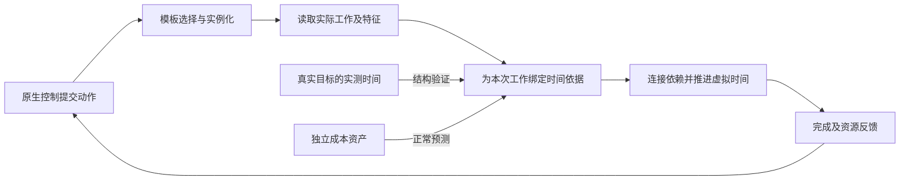

# 真实流量下的性能预测闭环计划

计划起始日期为 2026-11-19。

先用真实流量量清执行结构生成开销，再完成全节点真实时间注入的结构验证，以及由独立成本驱动、可比较两档并发配置的正常预测。

## 范围

| 项目 | 本窗口范围 |
| --- | --- |
| 实现域 | SGLang + Ascend，Qwen3-8B BF16，单实例 TP1。固定后端、页布局、KV 总容量与调度机制，选择两档 `max_running_requests`。 |
| 工作负载 | 取一段 200 条连续真实请求，分别用前 100 条和完整 200 条做结构测速。从互不重叠的片段预留常态和突发流量各一段。原有小案例用于日常回归。 |
| 性能结果 | 每个配置和流量组合的首 token 时延、每请求平均输出间隔及生成吞吐。保留成本覆盖、实测误差、配置排序和仿真墙钟。 |
| 泛化主张 | 同一实现域内，同一套模板与成本数据能否覆盖未参与开发的到达节奏、长度组合和并发设置。 |

首轮选择一套固定的原生单实例 serving 机制，覆盖组批、排队、KV 读写和释放。跨模型、跨拓扑、真实 MoE 路由和相对批级模型的收益进入后续窗口。

## 两条执行闭环

### 用全节点真实时间验证执行结构

1. 对同一目标配置和同一请求序列运行原生 serving。以同一业务起点记录实际到达、每项工作的开始与完成，以及原生控制可见的时钟读取、唤醒、同步和传输的时间边界。解释原始记录时分别发布**用于注入的时间事实**和**仅供对照工具读取的原生粗图、状态与输出**。来源模板提前独立取得。
2. 从相同逻辑初态运行仿真。原生控制自己选批和提交动作，核心自己生成目标节点、连接依赖并处理资源。时间条件只绑定到本次已经确定的工作和时间边界。匹配以请求、阶段、token 范围、参与者、语义作用域和端点角色为依据。排序序号用于报告首处差异。注入的范围是实际到达与工作、通知等事件的时间。批次、路由、状态查询结果、资源分配、构图绑定和依赖关系由本次执行的各自生产者计算。
3. **全节点覆盖是本路径的验收条件。** 覆盖范围是本次粗图的全部工作与事件，以及实际影响执行的外部时间边界。每个实际计时工作都要有对应的真实起止时间或逐端点校准区间。可分离的实测服务时间按工作输入，等待与设备异步尾部分别保存。纯逻辑节点逐个关联同一实测事件，或按可独立核对的确定性关系从实测端点导出时刻或校准区间。记录全图每个工作及事件的依据，核对真实工作与预测工作的对应，以及时间条件是否均按唯一身份消费。只有父调用包络、后继时间上界、范围过宽以致无法确定必要先后、缺测或冲突时，保留首处缺口及受影响范围，结论为未取得全节点验证。
4. 仿真器输出本次独立生成的图、实际消费的时间依据、状态变化和请求输出。独立比较工具核对必要工作和边、端口、KV 生命周期及请求效果。强制完成时间会掩盖部分缺边，所以必要因果要在图和资源关系上单独核对。

当前旁路按根端口或资源尾部关联条件，部分工作只有后继事件推导的时间上界。当前执行循环也可从旁路读取构图绑定。本窗口在既有 `ExecutionInputs` 入口内补齐逐工作、逐端点的实测匹配，完整验证时由本次动作提供构图绑定。条件中的身份用于核对动作并定位测量。 [现有旁路绑定](../../../src/markov/serving/execution_inputs.cpp#L176) · [现有后继上界处理](../../../src/markov/execution/timing.cpp#L45) · [当前构图绑定](../../../src/markov/serving/session.cpp#L45)

### 正常性能预测

用户用模型、配置和 workload 启动。正式入口只为任务提供匹配的来源模板与独立成本资产，按 workload 声明的时间交付请求。每次原生控制提交动作后，核心实例化子图，性能层按实际工作及当前特征估计服务时长。资源与依赖决定开始及完成，完成反馈驱动下一次组批、状态变化和请求输出，直至请求全部收口。

时间依据来自独立采样及其成本模型。正常预测只从该模型取得服务时长，具体绝对时刻由仿真推算。独立目标的实测条件、图和结果由验证任务持有，正常预测只挂载本路径所需输入。预测结束后依据独立原生结果评价 TTFT、TPOT、吞吐、配置排序和覆盖情况。

### 共用执行与职责

两条路径共享原生控制、模板选择和实例化、工作身份、依赖连接、KV 和槽位管理、`Timeline` 及完成反馈。任务装配时选择时间来源。现有 `GraphTiming` 的 `work_ns` 承接各工作的服务时间，`boundaries` 承接验证用的实测端点约束。给定耗时只用于测速和开发回归。 [动作执行入口](../../../src/markov/serving/session.cpp#L39) · [时间接口](../../../src/markov/execution/timing.hpp#L27)

| 职责 | 交接与归属 |
| --- | --- |
| 原生控制与框架适配 | 原生控制决定组批、阶段与请求进度。适配器提供动作和实际参数，性能模型通过完成反馈间接影响后续决策。 |
| 模板与图 | 保有作用域、运行资源、端口和必要因果。在实例化时一次取得计时工作及其已绑定特征。工作身份沿用规范化模板定义内的位置和实际实现，等价子图可复用算法及数据。 |
| 资源与执行 | 核心资源服务持有槽位、KV 与驻留。依赖层和时间线统一处理资源阻塞、信号、设备异步尾部和释放。成本确需页布局等资源特征时，从拥有者取得最小的只读信息。 |
| 采集适配 | 框架侧说明原生工作归属，runtime 侧取得 CPU、设备与传输证据。结构目标和独立成本样本共用工作身份与测量切口，按各自的用途发布。 |
| 验证侧 | 校准并匹配真实时间，交给 `ExecutionInputs` 消费，核对全节点覆盖。独立比较工具持有原生图与状态证据。 |
| 性能层 | 独立规划采样、发布样本并拟合。在线按已绑定工作查询服务时长或报告覆盖缺口。查询在 C++ 执行进程内进行。 |
| 正式入口与示例 | 正式入口装配本任务需要的模板和时间资产。真实 trace 转换、测速编排和独立比较放在 `example`，通过正式入口复用业务逻辑。 |

在线资产读取与估时集中在 `src/markov/performance/`，由现有 serving 装配接入。`execution/` 继续消费 `GraphTiming`。原生测量由 `src/collection` 的框架与 runtime 适配器提供，正式资产发布与任务生命周期归 `src/workflow`。采样规划与在线查询共用工作和特征合同，特征从现有参数及实际资源绑定取得。新增字段只由能够证明该事实的部件生产。

一次动作在绑定完成后、进入时间线前发起估时。以 Attention 为例，同一子图的多个设备区间、CPU 提交和搬运分别取得各自的服务时间，父作用域通过完成事件组合。缺少任一必需时长时，在插入时间线前交还可定位的覆盖缺口。新成本资产发布后从统一初态重算。

主动作在 `ServingSession` 取时，`CpuMessages` 还给消息两端服务和传输计时。接入前逐个核对 TP1 实际触发的入口，将有成本的工作同时纳入实测条件匹配与成本查询合同。通知与纯同步沿既有因果关系推进。 [CPU 服务与传输入口](../../../src/markov/controller/cpu_messages.cpp#L30)

## S0 导入真实流量与准备结构资产

- 从 Azure 2024 数据选择一段连续 200 条请求。以首条时间戳为原点，保留到达间隔、同刻顺序及逐请求输入和输出长度配对。登记数据版本、片段范围、单位、请求数、输入和输出 token 总量、长度分布、到达跨度及突发密度。超出模型或原生容量的记录给出明确依据，按完整片段选择可运行窗口。转换器生成现有 workload 格式。 [Azure 2024 请求 trace](https://github.com/Azure/AzurePublicDataset/blob/master/AzureLLMInferenceDataset2024.md)
- 以同一片段的前 100 条及完整 200 条形成测速输入。按原始流量特征提前划定互不重叠的常态与突发留出。留出规模结合 token 总量和测速预算定案，持有实际请求和真值的产物在最终评价阶段使用。先在开发片段选定两档并发配置，使后续有实质的排队或资源压力差异。
- 核对模型、加载模式、dtype、后端、页布局、模板、实际镜像和硬件环境。优先复用适用来源。现有采集入口使用 dummy 权重，结果以所用加载模式为边界。选择真实权重时，结构来源、性能样本和真值按实际实现取得相符的资格。匿名回放以已记录的到达和输出长度为输入。
- 用最小开发样本确认流程可进入常见 Prefill/Decode 和请求退出路径。处理模板缺口前先查来源、变换或控制交接的归属，对必要分支集中取证。用既有小案例维持快速开发回归，并在测速前记录可接受的真实流量回归墙钟及预算。

**交付**为可复现的 100/200 条测速输入、留出登记、配置与资产适用性记录。请求序列和时间单位经核对后可通过正式入口生成目标结构。

## S1 测执行结构生成速度

在同一机器、实际镜像、模板、配置和给定耗时下跑 100/200 条，关闭明细。固定时长假设应触发有代表性的组批或排队，并记录实际行为。该时间输入用于测仿真程序本身的开销。冷启动和稳定运行分别计量，在差异会影响结论时做必要的重复测量。

- **主量**为公开入口从启动到结果发布的墙钟、动作数、工作区间数、事件数、完成请求数、token 总量与峰值内存。另记选择、实例化和绑定依赖的累计用时，给出结构生成的单位工作量开销。
- **定位量**区分资产准备、容器启动、原生交互、结构生成、推进与回收、结果发布。进程间等待按实际所在区间计量。先用现有计时和进程剖析，确需细分时使用可关闭的聚合计时。源采集、模板生产、真值对照各自计时。
- **对照**选一个案例比较相同输入及时间条件下的明细开关和业务输出；必要的依赖检查用小案例。给定耗时改变组批时保留真实动作和事件计数，按同类工作量解释墙钟变化。

**交付**为两档完整基线、耗时构成和瓶颈证据。按 S0 记录的回归预算判断是否启动 S2，达标可直接进入 S3。

## S2 按需优化预测速度

超出预期时先处理一项对真实流量最有影响、证据明确的热点，沿用现有原生决策、子图和时间线方法。下列方案由实测耗时决定。

| 耗时集中位置 | 优化与应核对的行为 |
| --- | --- |
| 资产解析、写盘和准备 | 同一任务内复用已校验的模板及公共上下文，减少重复转换与拷贝，明细按需输出。核对资产选择、结果发布及故障后的产物一致性。 |
| 选择、实例化和连接 | 将重复的静态解析收敛到模板准备，复用已证明相同的结构信息。核对 guard、真实参数、运行实例的张量和 KV 绑定，以及跨作用域的必要依赖。 |
| 控制交互与事件推进 | 先定位重复查询、协议交接、活动状态扫描或临时对象分配。沿现有所有权回收已消费状态，复查原生可见的完成顺序与等待、就绪和释放。 |

先静态追踪根因和所有消费者，集中修改后统一构建。在固定的 100/200 条用例上复测墙钟和内存，用既有小例或必要明细确认请求输出与必要因果一致。达到 S0 的反馈期望且行为核对通过时收口。若主要耗时来自应保留的工作，记录剩余差距、随规模增长的代价及已取得的收益，据此定下性能阶段可承受的回归范围。后续是否改变图结构须有独立的因果与性能依据。

## S3 明确计时职责与测量资格

从正式入口追到虚拟时钟，盘点目标域执行的计时工作、逻辑边界和潜在缺项。按真实生产者与消费者确定查询对象，以及每种特征首次可取得的位置。

| 工作区间 | 工作特征与测量依据 |
| --- | --- |
| CPU 自身服务 | 同一线程和调用切口中的实际工作，按阶段、成员数、数据量或相关操作数描述。父子区间排他计时，CPU 提交和设备完成分别留证。原生控制进程的宿主运行时间计入测速。 |
| NPU 计算 | 以当前子图的实际实现、shape、dtype、布局和 attention query/context 等描述。同一 stream 区间内多项设备任务可以内部细测，再聚合为该区间的服务时间。 |
| 搬运 | 同步调用明确自身搬运边界，异步搬运定位实际设备任务及资源。特征包括方向、字节与内存位置；主机提交仍属于 CPU 工作。 |
| 等待与完成通知 | 以生产者、资源及同步事件表达约束。若发现实际服务被包在纯边界内，先定真实作用和归属，再决定是否显式建模。 |

- 以模板定义、具体区间、执行资源和必要参数统一关联来源测量、需求生成和目标查询。运行中的请求编号、事件序号和 SDK kernel 名用于定位证据。结构和成本的复用各自要求实现及测量边界相容。
- 用代表性的 CPU、NPU 和搬运工作试测。核对测量开始与结束、时钟分辨率、预热与观察扰动。用实际卸载对应观察器的开发对照核实回调、设备记录和请求到达受影响的程度。实测端点可用于结构核对，独立成本标签要求能分离该工作的自身服务。
- 用一个固定开发案例确认逐工作和事件的同一身份关联，包括 CPU 控制实际消费的到达、通知及传输边界。同步核对全节点覆盖统计和首处缺测报告。沿用现有图和时间线承接这套证据。

**交付**为目标域计时入口清单、工作特征合同、代表性成本测量资格和开发案例的全节点时间覆盖报告。缺测或计费边界不成立时回查测量切口和归属，明确已有证据可覆盖的范围后再开展采样。

## S4 构造有界采样与成本基线

1. 由同一个工作合同从开发展开和模板的可变参数产生需求，按已覆盖特征和适用域归并。以实际开发流量的批次及长度范围构造短请求配方。动态调度可能产生新组合，固定本轮探索范围和预算。
2. 优先在一个已预热的原生会话内复用模型和底层入口，执行去重后的配方。核实实际命中成员、形状、实现和资源边界，按资格发布有效标签。记录启动、预热、有效观测、后处理和峰值存储。相同配方停止提供新证据时结束该轮。
3. 同一有效特征点有重复观测时，先用中位数建立实测基线。需要覆盖未直接测得的特征点时，只在有样本支撑的范围内采用插值或简单拟合。用独立于拟合的开发样本核对局部误差和覆盖资格。出现系统性误差时追查测量、关键特征或区间归属。最终留出流量和真值只用于 S6。

**交付**为可加载的成本资产、覆盖范围及可复现的需求到采样记录。资产描述实现域、特征范围、服务时间及测量依据。样本不足和域外需求形成明确缺口，后续定点补采须有新的预期证据及预算。

## S5 接入性能层并打通正式预测

- 同步修改实际入口、任务装配及 C++ 消费者，在任务启动时选定时间来源并装载对应资产。性能模式可用配置、workload、模板和成本资产独立启动。正式预测过程用同进程成本查询，沿用现有归属和生命周期，正常路径无需为每项工作跨语言通信、解析通用 JSON 或写入调试明细。
- 用小例核对时间交接，再在真实开发流量跑两档并发。检查查询消耗与样本覆盖、模拟完成驱动的组批、KV 生命周期、逐请求输出，以及缺成本时的明确结果。时间改变后从统一初态重算，合法组批变化由原生控制决定。
- 复用一份开发真值完成两条闭环回归。结构验证逐项消费真实时间，核对必要因果和资源效果。正常预测只挂载配置、workload、模板和独立成本资产，以自身完成反馈跑到请求结束。再对照真值按工作类型定位局部误差和高影响路径。确认测量偏差、特征遗漏或覆盖缺口后安排对应修正或有界补采，并复用开发证据检查根因是否消除。
- 复用 S1 口径测模型接入后的墙钟，并记录查询时间及动作、事件规模。保持给定耗时基线可复跑，以归因成本查询、组批变化和其它执行开销。若查询成为热点，优先复用加载时建立的索引和同一动作内的等价特征查询。

**交付**为按两条路径运行的开发示例、全节点时间覆盖和独立成本预测结果。成本缺口包含工作身份、特征和适用条件，供采样规划复用。两条路径分别验证输入及输出的独立性后再冻结资产。

## S6 冻结资产并做独立对照

冻结程序、镜像、模板、成本、两档配置、两个留出片段和指标口径，四个组合均走结构验证和正常预测。每个组合优先取得一次同时具备完整时间证据与性能评价资格的原生真值。若 S3 证明详细观察足以改变性能评价，则详尽的原生观测承接结构验证，轻量原生测量承接性能评分，各自以相应运行的记录为依据。依靠已保留的目标记录复核，先收齐本轮结果，再处理失败。

1. **结构对照。** 核对逐工作与事件的真实时间覆盖、实际消费和校准不确定性。用独立原生粗图和状态证据比较必要工作、边、请求及资源效果。全节点时间覆盖与必要结构核对同时成立才通过该组合。
2. **性能对照。** 用已声明的到达、模板和独立成本运行自主预测，完成全部请求。原生端测服务入口和调度器 token 输出，记录实际交付相对声明到达的偏差。两边对齐业务起点和端口，实际入口扰动影响组批或结论时标明真值资格。允许预测时序引起原生调度产生合法的组批变化。
3. **指标。** TTFT 以服务入口到首 token 为准，TPOT 为多 token 请求首末输出之差除以间隔数，吞吐为输出 token 总数除以从流量起点至最后一个输出的时长。每个组合分别计算 TTFT、TPOT 的逐请求 MAPE。四个组合均有合格测量和完整预测时才等权汇总，两个汇总指标以 **MAPE < 6%** 为目标。报告样本数、P95 TTFT、吞吐、配置排序和测量不确定性。单 token 请求只参加适用指标，未完成请求、缺端点或零分母保留相应结论，实测差异低于分辨能力时记为无法区分。

**交付**为四个组合的原生、结构和自主性能结果，以及覆盖、精度和墙钟报告。用于修正规则或拟合的数据转为开发证据，保留原独立结论。

## S7 归因与交付闭环结果

- 从首处有影响的差异追踪到相应职责。给定实测条件下出现的结构差异回查模板、控制交接或评价证据。自主时序偏离时沿同类工作比较服务时间、状态与队列变化，再判断是成本测量和覆盖不足、模型偏差，还是完成时间变化造成的合法调度变化。
- 功能收口要求四个组合完成全节点实测条件下的结构验证，并复用同一模板与成本资产自主生成完整请求输出。按 S6 的有效证据单独说明精度。出现运行前提失败、时间覆盖不足、缺成本或无效测量时，给出失败位置、受影响路径及最小的后续修正依据。
- 保留能解释配置效果的原生与预测证据，以及真实流量下的仿真耗时。阶段总结说明何处已能泛化、何处需要新来源或成本样本，为后续跨域和批级基线比较留下同口径输入。

## 实施与交付

- 阶段启动核对上阶段交付、可用证据及预算，按现状更新待做范围。开发先静态梳理入口、所有权和调用链，成批完成修改后在 modeling Docker 内统一做 C++23 构建及必要运行。日常回归优先复用能触发当前机制的小案例，100/200 条用于测速、优化复测及相应的真实流量开发回归。
- 每阶段收尾沿 Git 变更检查关联生产者、消费者及资产，重点审查层次、逻辑、代码规模和可删除的重复路径。记录确认的根因、范围和剩余风险。代码、文档和数据核对后，在正式阶段边界分层提交推送，使用 `type(scope): summary`，核对远端提交后作为下一阶段基线。
- 产物归入本次时间根。保留可复用来源、正式模板与成本资产、留出真值、精简结果、必要诊断及预算记录；清理本轮已消费且无后续用途的中间件。本地数据、构建和模型文件留在 Git 之外。
- 阶段状态写入状态文档，实际行动与证据写入日志。窗口结束时将结果、覆盖边界和遗留汇总进项目主工作流，然后撤下窗口文档。
